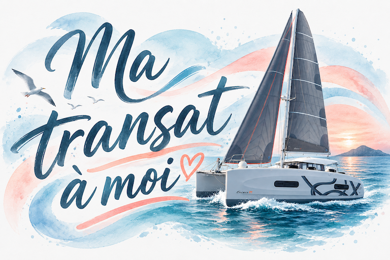

An exclusive track made wit a lot of ❤️ to keep my brother company during his solo transatlantic crossing. Beyond proud of him!



As Eric **just crossed the finish line** 🥳, I wanted to release the single version of the track. It was also part of the mix [Ta route du rhume à toi - House mix]().

## Lyrics

```text
[Verse 1]
Mon frère Eric part au large
Sur Skiboo 2, cœur solide
La Rochelle dans le matin
Et l’océan comme un défi

Il trace sa route en solitaire
Le vent au front, la joie devant
Vers la Guadeloupe en lumière
Avant la course, tranquillement

[Pre-Chorus]
Début octobre, il s’élance
Avec l’envie, avec l’élan
En trente jours, il s'avance
Et le sourire au large des vents

[Chorus]
Ma transat à moi
C’est Eric, c’est lui
Ma transat à moi
Skiboo 2 qui rit

Ma transat à moi
Jusqu’à Pointe-à-Pitre
Ma transat à moi
Avant tout le monde, vite (ma transat à moi)

[Verse 2]
L'océan devient son sommet,
Face aux vagues qu'il doit franchir.
Chaque millier de milles au grand large
L'emmène au bout de ses désirs.

Dans la houle et la solitude,
Il monte tout en haut du vent,
Oubliant toutes les habitudes,
Il as enfin gravi son Everest.

[Pre-Chorus]
Il garde le cap, il tient la ligne
Sous les étoiles, sous le soleil
Chaque jour qui passe le désigne
Comme un marin sans frayeur

[Chorus]
Ma transat à moi
C’est Eric, c’est lui
Ma transat à moi
Skiboo 2 qui rit

Ma transat à moi
Jusqu’à Pointe-à-Pitre
Ma transat à moi
Avant tout le monde, vite (ma transat à moi)

[Bridge]
Oh, mon frère, quel bel écart
Entre le port et les clichés
Tu files devant, le cap en main
Je suis si fier de toi !

[Final Chorus]
Ma transat à moi
C’est Eric, c’est lui
Ma transat à moi
Skiboo 2 qui rit

Ma transat à moi
Jusqu’à Pointe-à-Pitre
Ma transat à moi
Avant tout le monde, vite (ma transat à moi)
```
